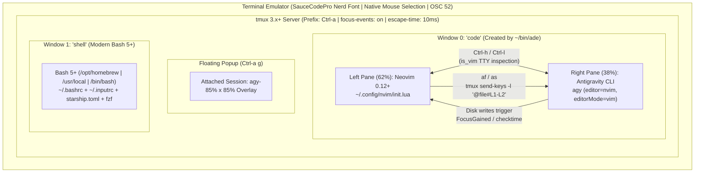

# Architecture & Implementation Details (`Gino's Super Dev Env`)

This document explains how the components of **Gino's Super Dev Env (`dev-env`)** are architected and how **Bash 5.3**, **GNU Readline**, **Starship**, **`tmux` 3.7+**, **Neovim 0.12+**, and **Antigravity CLI (`agy`)** communicate with each other.

---

## 1. System Architecture Overview



---

## 2. Terminal & Multiplexer Layer (`templates/tmux/tmux.conf`)

### 2.1 Migrating from `tmux 1.x` / GNU `screen` to `tmux 3.x+` (macOS & Linux)
Older `tmux` configurations used options removed in `tmux 2.1+` and `3.x`:
- `setw -g mode-mouse on` was replaced by `set -g mouse on|off`. Because native terminal text selection without holding `Option`/`Shift` is preferred (matching `.vimrc`'s disabled mouse), we explicitly set `set -g mouse off` and use `Ctrl-a Esc` for keyboard-driven `vi` copy-mode wired directly to `~/bin/dev-copy` (which handles macOS `pbcopy`, Linux Wayland `wl-copy`, Linux X11 `xclip`/`xsel`, and headless SSH via ANSI OSC 52 escape sequences alongside `set -s set-clipboard on`).
- `setw -g window-status-current-bg red` was replaced by unified style syntax: `setw -g window-status-current-style bg=red,fg=white,bold`.
- Linux's `/proc/loadavg` does not exist on macOS Darwin kernels. The status bar uses:
  ```sh
  sysctl -n vm.loadavg 2>/dev/null | awk '{print $2,$3,$4}' || cut -d " " -f 1-3 /proc/loadavg 2>/dev/null
  ```
  so the `[ host ][ windows ][ loadavg ][ YYYY-MM-DD HH:MM:SS ]` status bar works identically on both macOS and Linux.
- Cross-platform shell resolution cascades from `/bin/bash` (Linux) to `/usr/local/bin/bash` (Intel Mac Homebrew) and `/opt/homebrew/bin/bash` (Apple Silicon Mac Homebrew).

### 2.2 Escape Time, Focus Events, and Cursor Shape Passthrough
Three low-level terminal settings in `tmux.conf` are essential for Neovim and Bash `vi`-mode:
1. **`set -sg escape-time 10`**: By default, `tmux` waits 500ms after receiving `<Esc>` to determine if it is part of a meta sequence. Lowering this to `10ms` makes switching from Insert to Normal mode in both Neovim and Bash 5.3 instantaneous.
2. **`set -g focus-events on`**: Instructs `tmux` to emit ANSI focus-in (`\e[I`) and focus-out (`\e[O`) sequences to panes when you move between them. Neovim hooks into `FocusGained` to run `:checktime`, immediately reloading any file edited by `agy`.
3. **DECSCUSR Cursor Shape Passthrough**:
   ```tmux
   set -ag terminal-overrides ',*:Ss=\E[%p1%d q:Se=\E[2 q'
   ```
   Allows both Neovim and GNU Readline (`~/.inputrc`) inside `tmux` to change the outer iTerm2 cursor between a thin beam (`\e[6 q`) in Insert mode and a solid block (`\e[2 q`) in Normal mode.

---

## 3. Shell, Readline & Prompt Layer (`templates/bash/` & `starship.toml`)

### 3.1 Why Homebrew Bash 5.3 Over macOS `/bin/bash` 3.2
macOS ships `/bin/bash` pinned to **GNU Bash 3.2.57 (2007)** for GPLv2 licensing reasons. Bash 3.2 uses an archaic Readline version that lacks mode-string prompt escapes and DECSCUSR cursor transitions.
- `tmux.conf` automatically detects and sets `default-shell` to `/usr/local/bin/bash` (Intel Homebrew) or `/opt/homebrew/bin/bash` (Apple Silicon Homebrew), running **GNU Bash 5.3+**.

### 3.2 Zero-Width Readline `vi`-Mode Indicator (`templates/bash/inputrc`)
When `set editing-mode vi` and `set show-mode-in-prompt on` are enabled in `~/.inputrc`, Readline prepends `vi-ins-mode-string` or `vi-cmd-mode-string` to the last line of the prompt (right before Starship's `❯` character).
To prevent Readline from miscalculating cursor column offsets when wrapping long lines, non-printing ANSI color and cursor-shape sequences **must** be wrapped in `\1` (`RL_PROMPT_START_IGNORE`) and `\2` (`RL_PROMPT_END_IGNORE`):
```readline
set vi-ins-mode-string \1\e[32m\2[I]\1\e[0m\e[6 q\2 
set vi-cmd-mode-string \1\e[36;1m\2[N]\1\e[0m\e[2 q\2 
```
- Only the 4 printable characters (`[I] ` or `[N] `) are counted by Readline's line-wrapping engine, while `\e[6 q` (bar cursor) and `\e[2 q` (block cursor) switch the cursor shape in real time as you press `<Esc>`, `i`, `a`, or `c`.

### 3.3 Two-Line Starship Prompt (`templates/starship/starship.toml`)
When working inside side-by-side `tmux` panes (`62%` editor / `38%` agent or shell), single-line prompts that include directory paths and Git branch names leave very little horizontal room for typing commands.
The two-line Starship layout solves this:
- **Line 1** renders contextual metadata asynchronously (capped at `command_timeout = 1000` ms):
  - `username` + `hostname` (`ssh_only = true`): Suppressed locally because `tmux`'s left status bar already displays `[ #H ]`, but automatically highlighted in yellow when inside an SSH session.
  - `directory` (`truncate_to_repo = true`): Collapses parent paths to the Git repository root name.
  - `git_branch` + `git_status`: Displays branch name and concise counters (`!n` modified, `+n` staged, `?n` untracked, `⇡n⇣m` ahead/behind).
  - Language modules (`python`, `nodejs`, `golang`, `rust`, `java`, `docker_context`): Triggered only when marker files (`pyproject.toml`, `package.json`, `go.mod`, etc.) exist in the working directory.
  - `cmd_duration` (`min_time = 2_000`): Displays `took Xs` only when a command runs for more than 2 seconds.
- **Line 2** starts at column 1 with Readline's `[I]`/`[N]` badge, an optional red `✘ <exit_code>` on failure, and `❯`.

---

## 4. Neovim 0.12 <-> `tmux` <-> Antigravity (`agy`) Integration

### 4.1 Seamless `Ctrl-h/j/k/l` Navigation Without Hijacking `agy`
In `tmux.conf`, `C-h`, `C-j`, `C-k`, and `C-l` are bound in the root key table (`bind -n`) using a process check against the active pane's TTY (`#{pane_tty}`):
```tmux
is_vim="ps -o state= -o comm= -t '#{pane_tty}' | grep -iqE '^[^TXZ ]+ +(\\S+\\/)?g?(view|l?n?vim?x?|fzf)(diff)?$'"
```
1. **When focused in Neovim**: `is_vim` evaluates to true, so `tmux` forwards `C-h/j/k/l` to Neovim. Inside `init.lua`, `tmux_or_nvim_nav()` attempts `wincmd h/j/k/l` first; if the cursor is already at the edge of the outermost Neovim split (`cur_win == new_win`), Neovim invokes `tmux select-pane -L/-D/-U/-R` to cross seamlessly into the adjacent `tmux` pane.
2. **When focused in `agy` or `bash`**: `is_vim` evaluates to false, so `Ctrl-h` moves straight back to the Neovim pane on the left.

### 4.2 Sending File & Line-Range References from Neovim to `agy`
Antigravity CLI (`agy`) understands `@path/to/file` and `@path/to/file#Lstart-Lend` context mentions.
In `templates/nvim/init.lua`, `send_to_agy_pane(text)` inspects the current `tmux` window's panes via:
```lua
tmux list-panes -F "#{pane_id} #{pane_active} #{pane_current_command}"
```
It locates the inactive pane running `agy` (or falls back to the secondary pane in the window), injects the reference string literally via `tmux send-keys -t <pane_id> -l "<ref> "`, and focuses the `agy` pane so you can immediately type your question or instruction.
- **`<Space>af` (Normal mode)**: Sends `@relative/path/to/file`.
- **`<Space>as` (Visual mode)**: Calculates the visual selection bounds (`line("v")` to `line(".")`), formats `@relative/path/to/file#L10-L25`, exits visual mode, and sends it to `agy`.

### 4.3 Real-Time Disk Auto-Reload (`autoread` + `checktime`)
When `agy` edits files in your workspace using its file tools, Neovim's `AntigravityBridge` autocommand group triggers `silent! checktime` on `FocusGained`, `BufEnter`, `CursorHold`, and `CursorHoldI` (every `250ms` of idle time via `opt.updatetime = 250`).
When a buffer is reloaded from disk, `FileChangedShellPost` fires a non-blocking notification (`Buffer auto-reloaded (updated on disk by agy)`) and `gitsigns.nvim` updates the gutter diff markers in place.

---

## 5. Security, Scrubbing & Installer Architecture (`install.sh`)

To make `dev-env` safe to publish to a public GitHub repository:
1. **Strict Separation of Code and Secrets**:
   - No API tokens, usernames, or private project names exist anywhere in `templates/` or `bin/`.
   - Private environment variables (such as `HOMEBREW_GITHUB_API_TOKEN`) are isolated in `~/.secrets` with `0600` (`-rw-------`) file permissions and sourced at runtime by `~/.bash_profile` and `~/.bashrc`.
   - `.gitignore` blocks `.secrets`, `*.secrets`, `*.local`, and `*.bak`.
2. **Template Rendering (`*.tmpl`)**:
   - `templates/bash/bash_profile.tmpl` and `templates/antigravity/settings.json.tmpl` use explicit `{{GCP_PROJECT}}`, `{{GCP_LOCATION}}`, `{{WORKSPACE_DIR}}`, and `{{MULTIPLEXER_PROMPT}}` placeholders.
   - `install.sh` auto-detects existing local settings as defaults, prompts the user interactively (or accepts `--defaults`), and renders the final files into `~` and `~/.gemini/antigravity-cli/settings.json`.
3. **Transactional Backups & Rollback**:
   - Every run of `install.sh` snapshots existing dotfiles into `~/.dev-env-backup/<YYYYMMDD-HHMMSS>/` before writing any changes.
   - Running `./install.sh --uninstall` restores the latest snapshot in one command.
